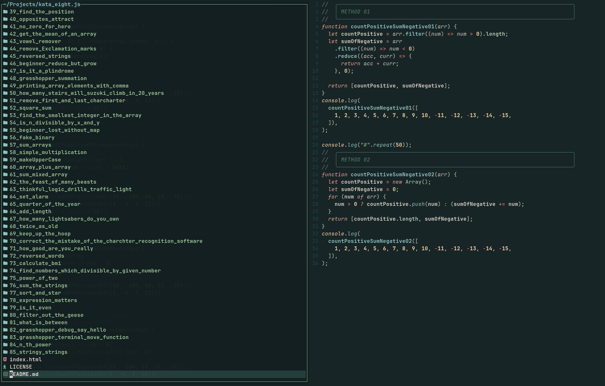

# Neovim Configuration

This is my personal Neovim configuration. It has been built around the
[mini.nvim][1] plugin---an amazing set of 40+ modules carefully crafted to
balance features versus implementation complexity.[^1]

> [!Note]
> This configuration is designed for Neovim **>=0.12**.



## Directory Structure

Key concepts:

- Each plugin has its own configuration file. This makes it easier to
  navigate to a specific plugin's configuration via a file picker. It also
  results in smaller files that are easier to read and maintain.

- Plugins are grouped into three subdirectories: `core/`, `exts/`, `mini/`, and
  `other/`. The `core/` directory holds essential configurations that are
  loaded first. `mini/` is dedicated to 'mini.nvim' plugins, while `other/`
  includes all remaining plugin configurations.

- Plugins are loaded in the order of `core/`, `exts/`, `mini/`, and `other/`. Within
  each of those directories, plugins are loaded in alphanumeric order as well.
  Numeric prefixes are used to ensure correct loading order.

- Most mappings are defined in `plugin/core/keymaps.lua` so it's easy to see
  what mappings have been used and what's still available. In some cases,
  this is not possible, but for the most part, it works well.

Below is an overview of the directory structure:

```txt
├── after                          # Sourced last (`:h after-directory`)
│   └── ftplugin/                  # Configurations for filetypes
├── colors/                        # Personal color schemes
├── init.lua                       # Main entry point
├── lsp/                           # LSP configurations
├── plugin                         # Plugins loaded via `vim.pack`
│   ├── core                       # Core configurations
│   │   ├── 10_options.lua         # General options
│   │   ├── 11_autocommands.lua    # General autocommands
│   │   ├── 12_functions.lua       # Custom functions
│   │   └── 13_mappings.lua        # Key mappings
│   ├── exts/                      # extends core
│   ├── mini/                      # Mini.nvim configurations
│   └── other/                     # Other plugin configurations
├── snippets/                      # Snippets for various filetypes
└── misc/                          # Spelling files
```

## Credits

My configuration is inspired by [echasnovski's](https://github.com/echasnovski/nvim).

[^1]:
    For those looking to explore this wonderful plugin, I highly recommend
    trying [MiniMax][2], which is a fully working self-contained Neovim
    configuration compatible with the current stable release of Neovim.

[1]: https://nvim-mini.org/mini.nvim/
[2]: https://nvim-mini.org/MiniMax/
